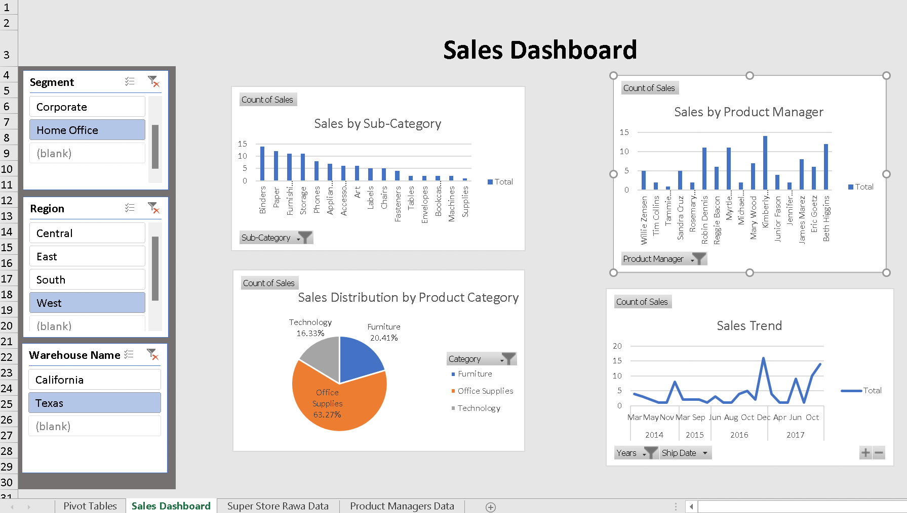

# Sales Performance Dashboard | Microsoft Excel

## Project Overview

This project presents an interactive Sales Performance Dashboard developed using Microsoft Excel. It focuses on analysing sales data, monitoring key performance indicators (KPIs), and exploring sales performance across different business dimensions.

## Project Objectives

- Monitor overall sales performance.
- Analyse revenue and sales trends.
- Compare performance across products and categories.
- Explore sales performance across different periods.
- Present key business metrics through an interactive dashboard.

## Tools & Technologies

- **Microsoft Excel:** Dashboard development and data analysis
- **PivotTables:** Data summarisation and analysis
- **PivotCharts:** Interactive data visualisation
- **XLOOKUP:** Data retrieval and lookup
- **Slicers:** Interactive filtering and exploration

## Key Features

- Interactive sales performance dashboard.
- KPI monitoring and visual reporting.
- Sales comparisons across business dimensions.
- Dynamic filtering using slicers.
- Visual presentation of sales trends.

## Files Included

- `Superstore.xlsx` – Excel dashboard and analysis file.

- `YOUR-EXCEL-FILENAME.xlsx` – Excel dashboard and analysis file.

## How to View the Project

1. Download the Excel file from this repository.
2. Open it using Microsoft Excel.
3. Explore the dashboard and interact with the available filters and slicers.

## Project Status

Completed.
## Dashboard Preview

### Sales Performance Dashboard

---

**Author:** Noor Ul Huda Qureshi

[GitHub Profile](https://github.com/HudaQureshi7500)
